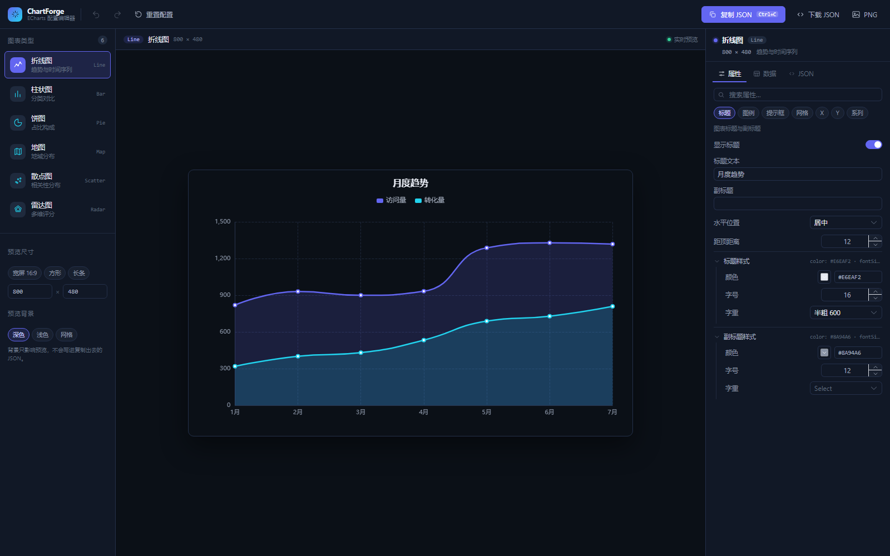

# ChartForge · ECharts 配置编辑器

一个用 Vue 3 + ECharts 做的可视化配置工具：左边选图表类型，右边调参数，中间实时看效果，调好后一键复制 `option` JSON 直接用到项目里。

不用再翻 ECharts 文档手写配置，也不用在代码里反复改数字看效果。



## 功能

- 支持 6 种图表：折线图、柱状图、饼图、地图、散点图、雷达图
- 属性面板按 `title / legend / tooltip / grid / xAxis / yAxis / series` 分组，带中文说明和取值限制
- 数据用表格编辑，不用拼字符串（饼图填名称+数值，散点填 X/Y，雷达按指标展开）
- 自带 JSON 编辑器，和预览双向同步，写错了只标红不会生效
- 预览尺寸可选 16:9 / 方形 / 长条或自定义宽高
- 预览背景支持深色 / 浅色 / 网格，切浅色会自动把文字和轴线换成深色，方便放进文档
- 支持撤销重做（Ctrl+Z）、各图表类型独立保存、刷新不丢编辑
- 导出：复制 JSON、下载 JSON 文件、导出 2 倍分辨率 PNG

## 技术栈

Vue 3.5 · TypeScript · Vite 8 · ECharts 6 · Pinia · Element Plus · Vitest

## 快速开始

需要 Node.js ≥ 20 和 pnpm 11。

```bash
pnpm install
pnpm dev        # http://localhost:5174
```

其他命令：

```bash
pnpm build      # 生产构建，输出到 dist/
pnpm preview    # 本地预览构建产物
pnpm typecheck  # 类型检查
pnpm test       # 单元测试
```

## 目录结构

```
src/
├─ components/
│  ├─ editor/        # 顶栏、图表库、预览画布、右侧面板
│  │  └─ panels/     # 属性 / 数据 / JSON 三个面板
│  ├─ chart/         # ECharts 实例封装
│  └─ ui/            # 图标
├─ config/           # 默认配置、属性 schema、ECharts 按需注册
├─ stores/           # 全局状态（当前图表、配置、历史）
├─ utils/            # 路径读写、历史栈、明暗配色、导出
└─ assets/geo/       # 中国地图数据
```

## 快捷键

| 操作 | 快捷键 |
| --- | --- |
| 复制当前配置 | `Ctrl + C` |
| 撤销 / 重做 | `Ctrl + Z` / `Ctrl + Shift + Z` |
| 切换图表类型 | `1` – `6` |

## 几点说明

- **安装报 `ERR_PNPM_IGNORED_BUILDS`**：pnpm 11 需要显式放行依赖安装脚本，仓库里的 `pnpm-workspace.yaml` 已经配好了 `allowBuilds: esbuild: true`，直接 `pnpm install` 即可。
- **地图不着色**：`china.json` 里的区域名带后缀（`广东省`、`北京市`），数据里的 `name` 要和它完全一致。
- **复制没反应**：Clipboard API 只在 `https` 或 `localhost` 下可用，内网 `http` 访问时请用「下载 JSON」。
